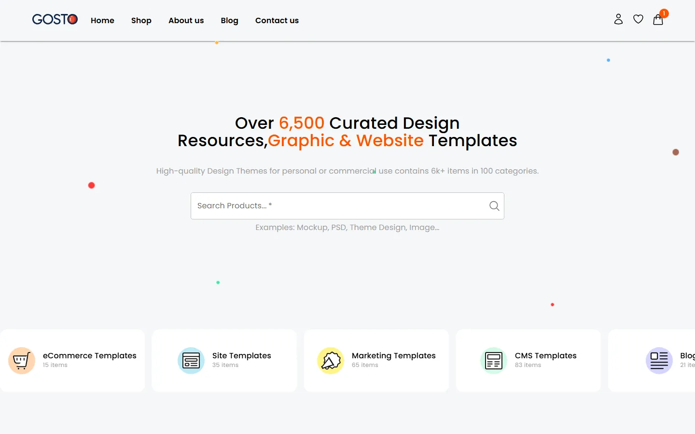

# Gosto Modern Ecommerce

An e-commerce storefront for selling website templates and graphics: a responsive React + TypeScript home page with
sliders, pricing plans and scroll animations.

**[Live demo](https://devmaheremad.com/gosto-ecommerce/)** · [More of my work](https://devmaheremad.com)



## What's inside
- **Home page built from typed, reusable sections:** hero, categories, trending products, best products, top-selling
  products, pricing plans (Free, Premium, Unlimited), testimonials and blog posts. Prop types live in `src/@types/`.
- **Sliders** with Swiper 8 and **scroll animations** with AOS.
- **Material UI 5** with a custom theme and responsive layouts.
- **React Router 6.** Routes for shop, about, blog, contact, profile and favorites are in place for the next pages.

## Stack
React 18 · TypeScript · Material UI 5 · Swiper 8 · AOS · React Router 6

## Run locally
```bash
git clone https://github.com/devmaheremad/gosto-ecommerce.git
cd gosto-ecommerce
npm install
npm start
```

`npm run deploy` builds the app and publishes it to GitHub Pages.

---

**Maher Almashharawi** · Senior Frontend Engineer (React, Next.js, TypeScript)
[devmaheremad.com](https://devmaheremad.com) · [Case studies](https://devmaheremad.com/case-studies/) · [LinkedIn](https://www.linkedin.com/in/devmaheremad) · hello@devmaheremad.com
